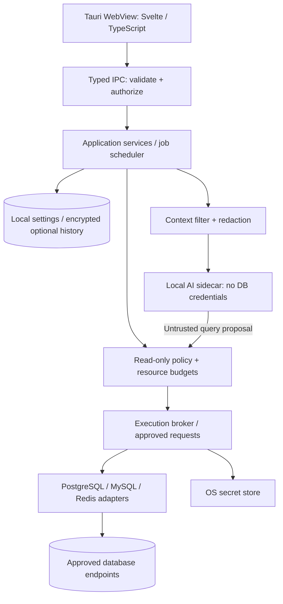

# แผนพัฒนา Desktop Database Workbench ส่วนตัว

วันที่จัดทำ: 13 ตุลาคม 2026  
สถานะ: แผนระยะยาว; มี PostgreSQL 17 preview แล้ว ดูขอบเขตที่ทำจริงใน README.md  
แพลตฟอร์มหลัก: macOS และ Windows  
แนวทาง: Rust core, UI ตอบสนองเร็ว, เก็บข้อมูลในเครื่อง, ตรวจสอบฐานข้อมูลแบบอ่านอย่างเดียว, AI ในเครื่อง

## 1. ข้อเสนอหลัก

ใช้ **Rust + Tauri 2 + Svelte + TypeScript + Vite** เป็นชุดเทคโนโลยีหลัก โดยให้ Rust จัดการ connection, credentials, query policy, streaming, monitoring และการสื่อสารกับ AI ส่วน UI รับผิดชอบการแสดงผลและรับคำสั่งจากผู้ใช้

เริ่มจาก **PostgreSQL, MySQL และ Redis** แล้วเพิ่ม SQLite, MariaDB และฐานข้อมูลอื่นผ่าน adapter ที่มีสัญญาการทำงานและชุดทดสอบร่วมกัน ไม่พยายามทำให้ฐานข้อมูลทุกชนิดใช้ SQL หรือมี metrics เหมือนกันทั้งหมด

**ปรับตามคำขอเพิ่มเติม:** ผู้ใช้เปิดหลายตารางเป็นแท็บ แก้ไขเซลล์ และเลือกแถวเพื่อเตรียมลบแล้วกด Save ได้จริง ข้อกำหนด read-only ใช้กับ SQL/AI execution ให้แยก typed manual UPDATE/DELETE ออกจาก query policy ชัดเจน ไม่มี Truncate/Empty API

Manual Save ต้องมี Primary key, ตรวจ UPDATE privileges ต่อคอลัมน์, parameter binding, เทียบค่าต้นฉบับ, atomic transaction, Save/Discard และ dirty-tab protection ไม่ retry เมื่อผล COMMIT ไม่แน่นอน ส่วน AI ในอนาคตต้องใช้ strict reader session ของตนเองและไม่รับ manual-save tool รายละเอียด implementation อยู่ใน `docs/DEVELOPMENT.md` ข้อกำหนด read-only ในส่วนถัดไปหมายถึงเส้นทาง query/AI และไม่ครอบคลุม typed manual Save นี้

**ความเป็นส่วนตัว:** เชื่อมต่อเฉพาะฐานข้อมูลและ SSH gateway ที่ผู้ใช้ตั้งใจอนุญาต ส่วน AI รันในเครื่อง ไม่มี cloud AI, analytics, crash upload, remote assets หรือระบบ sync ข้อมูลในรุ่นนี้

**ความคาดหวังที่ต้องตรงกัน:** Rust ช่วยเรื่องประสิทธิภาพและความปลอดภัยด้านหน่วยความจำ แต่ไม่รับประกันว่า SQL ปลอดภัยหรือข้อมูลไม่รั่วเอง สิ่งเหล่านี้ต้องออกแบบสิทธิ์ ตรวจสอบเส้นทางข้อมูล และทดสอบจริง ส่วน “ดีกว่าเครื่องมืออื่น” ให้พิสูจน์ด้วยผลทดสอบและความสะดวกในการใช้งาน ไม่กล่าวอ้างก่อนมีหลักฐาน

## 2. เป้าหมายและขอบเขตความเชื่อถือ

### 2.1 เป้าหมายที่ต้องผ่านก่อนใช้กับข้อมูลจริง

| เรื่อง | ข้อกำหนด |
|---|---|
| ข้ามแพลตฟอร์ม | ติดตั้งและใช้งานบน macOS Apple Silicon และ Windows x64; เพิ่ม Intel Mac/Windows ARM เมื่อมีเครื่องทดสอบและความต้องการ |
| ข้อมูลไม่ออกไปยังบุคคลที่สาม | ไม่มีเส้นทางส่ง schema, rows, SQL, credentials หรือ chat ไปยังผู้ให้บริการภายนอก |
| อ่านอย่างเดียว | บังคับด้วย application policy และบัญชีฐานข้อมูลสิทธิ์จำกัดร่วมกัน |
| UI และ SQL | ดูตาราง กรองข้อมูลผ่าน UI หรือเขียน SQL ในขอบเขตที่รองรับได้ |
| Monitoring | ดูสถานะ connections, activity, locks, query statistics, index usage และ metrics ตาม engine |
| AI | สนทนา อธิบาย schema/plan และเสนอหรือรัน bounded read query ผ่าน policy เดียวกัน |
| เบาและเร็ว | กำหนดงบ RAM, startup, latency, queue และผลลัพธ์; วัดรวมโปรเซสลูก |
| เพิ่ม/ถอดฟีเจอร์ | ใช้ modules, explicit dependencies, versioned contracts และทดสอบ configuration ที่รองรับ |
| ใช้งานออฟไลน์ | เปิดแอป อ่านข้อมูลในเครื่อง และใช้โมเดลที่นำเข้าแล้วได้โดยไม่ต้องติดต่ออินเทอร์เน็ต |

### 2.2 นิยาม “ข้อมูลไม่ออกนอกเครื่อง” ให้ใช้งานได้จริง

การเชื่อมต่อฐานข้อมูล remote ย่อมส่ง authentication และ query ไปยังฐานข้อมูลนั้น จึงนิยามนโยบายเป็น **ไม่ส่งข้อมูลไปยังปลายทางอื่นนอกเหนือจากฐานข้อมูล/SSH gateway ที่ผู้ใช้อนุญาต** และไม่ส่งข้อมูลไปให้ผู้ให้บริการ AI

หากต้องการไม่มี network traffic เลย ให้ใช้ฐานข้อมูลและ AI ในเครื่อง พร้อม environment ที่ตัด network ภายนอก การเปิดฐานข้อมูลบน cloud ที่ผู้ใช้เป็นเจ้าของยังถือว่าเป็น remote connection ซึ่งต้องแสดงให้เห็นชัด

สิ่งที่อยู่ในขอบเขตความเชื่อถือ: ระบบปฏิบัติการ, binary ที่ติดตั้ง, code ใน core/adapter ที่ผ่าน review, ฐานข้อมูลที่เชื่อมต่อ และผู้ดูแลฐานข้อมูล ข้อมูลใน rows, comments, object names, query plans และคำตอบจาก AI ถือเป็นข้อมูลที่ไม่เชื่อถือเสมอ

ไม่อ้างว่าป้องกันได้เมื่อเครื่องติด malware, ผู้ดูแล OS ถูกยึดสิทธิ์ หรือผู้ดูแลฐานข้อมูลจงใจเปลี่ยนฟังก์ชันที่เคยตรวจสอบแล้ว หลักประกันระดับสูงต้องมีการควบคุม OS, network และการเปลี่ยนแปลงฝั่งฐานข้อมูลร่วมด้วย

## 3. ภาษาและเทคโนโลยีที่แนะนำ

| ส่วน | ข้อเสนอ | เหตุผล/ข้อจำกัด |
|---|---|---|
| Core | Rust stable + Cargo workspace | ownership ชัด, types ช่วยบังคับขอบเขต, เหมาะกับ I/O และงานที่ต้องควบคุมทรัพยากร |
| Desktop shell | Tauri 2 | ใช้ WebView ของ OS และใช้ Rust backend ได้โดยตรง; ต้องทดสอบความแตกต่างของ WebView ทั้งสองระบบ |
| UI | Svelte + TypeScript strict | เหมาะกับ UI ที่ต้องมี state และ interaction มาก โดยแยก UI ออกจาก business logic |
| Frontend build | Vite + pnpm lockfile | build เป็น static assets; ไม่มี Node.js server ในแอปที่ติดตั้ง |
| Async I/O | Tokio | จัดการ connection, cancellation, bounded channels และงานเครือข่าย |
| PostgreSQL/MySQL | SQLx เป็นตัวเลือกตั้งต้น | ใช้ adapter แบบระบุ engine; ต้องพิสูจน์ dynamic type decoding, streaming และ cancellation ก่อนยืนยัน driver |
| Redis | redis-rs | adapter แยก command model จาก SQL และมี policy เฉพาะ Redis |
| SQL parsing | sqlparser-rs + dialect policy ที่เขียนเอง | ใช้สร้าง AST; parser ไม่ใช่ระบบพิสูจน์ว่า query ไม่มีผลข้างเคียง |
| SQL editor | CodeMirror 6 | ใช้ส่วนประกอบเฉพาะที่ต้องการและ lazy-load; completion จาก metadata ในเครื่อง |
| Data grid | headless table + TanStack Virtual | render เฉพาะ viewport; ต้องพัฒนา keyboard navigation และ accessibility เพิ่ม |
| กราฟ | SVG/Canvas ที่ bundle ในแอป | เริ่มจากกราฟไม่ซับซ้อน เลือก library หลังทดสอบขนาดและ accessibility |
| Local settings | SQLite | เก็บ settings, workspace layout และ metadata ที่ไม่เป็นความลับ; SQLite ปกติไม่ได้เข้ารหัสไฟล์ให้เอง |
| Secrets | OS credential store ผ่าน abstraction เช่น keyring | ใช้ macOS Keychain และ Windows credential protection; ทดสอบ backend ของเวอร์ชันที่เลือก |
| Sensitive persistence | audited AEAD library + key ใน OS store | เข้ารหัส chat/history ที่ผู้ใช้เลือกเก็บ; ไม่เขียน crypto เอง |
| Local AI | llama.cpp ผ่าน managed sidecar | inference เป็น C/C++ แยกจาก Rust app; เปิดเมื่อใช้และหยุดได้ |
| Contracts | Rust types → generated TypeScript/JSON Schema | ลด DTO ไม่ตรงกัน; generation tool เป็น build dependency ไม่ใช่ runtime service |
| Quality | Rust unit/integration/property tests + frontend tests + native smoke tests | ทดสอบข้อกำหนดความปลอดภัยกับฐานข้อมูลจริงใน environment ทดสอบ |

Tauri ใช้ WKWebView บน macOS และ WebView2 บน Windows จึงไม่ต้อง bundle browser engine เองในรูปแบบเดียวกับ Electron แต่ขนาดติดตั้งและ RAM จริงยังขึ้นกับ runtime และงานที่เปิดอยู่ ต้องวัด ไม่รับประกันจากชื่อ framework [Tauri process model](https://v2.tauri.app/concept/process-model/)

SQLx รองรับ PostgreSQL, MySQL และ SQLite แต่ SQL ที่ผู้ใช้พิมพ์ตอน runtime ไม่ได้ถูกตรวจความถูกต้องด้วย compile-time query macro อัตโนมัติ ควรใช้ typed engine adapters แทนการบังคับทุกอย่างผ่าน abstraction ที่ทำรายละเอียดเฉพาะ engine หายไป [SQLx](https://github.com/transact-rs/sqlx)

Tokio เหมาะกับ I/O; งาน parsing/formatting ขนาดใหญ่ให้เข้า bounded CPU worker และ AI อยู่คนละโปรเซส เพื่อไม่ให้แย่ง event loop [Tokio tutorial](https://tokio.rs/tokio/tutorial)

### 3.1 ทางเลือกที่พิจารณาแล้ว

| ทางเลือก | เหมาะเมื่อ | คำตัดสินสำหรับงานนี้ |
|---|---|---|
| Tauri + Svelte | ต้องการ rich desktop UI และ Rust core | เลือกเป็นแนวทางหลัก |
| Tauri + React | ทีมถนัด React หรือมี grid/component เดิม | ใช้แทน Svelte ได้; ความถนัดและผล benchmark สำคัญกว่าการเปลี่ยน framework |
| Rust native UI | ต้องการลด web stack และยอมลงทุน editor/grid/accessibility | ทำ spike ได้ แต่ไม่เลือกเป็นเส้นทางแรกของ workbench ที่มี UI ซับซ้อน |
| Electron | ต้องการ ecosystem และ browser runtime ที่ควบคุมเวอร์ชันได้สม่ำเสมอ | เป็นทางเลือก แต่ต้องยอมรับงบ package/runtime ที่ต่างออกไป |
| Swift + C#/WinUI | ต้องการ native integration ลึกมากทั้งสอง OS | มี UI สองชุด จึงเพิ่มต้นทุนดูแลสำหรับงานส่วนตัว |
| Python backend | งานวิเคราะห์เฉพาะทางที่มี library จำเป็น | ไม่ใช้เป็น runtime หลักของแอปนี้ |

ไม่จำเป็นต้องเขียน Rust 100%: Rust รับผิดชอบส่วนสำคัญที่ต้องควบคุม ส่วน TypeScript/Svelte ช่วยให้พัฒนา UI และปรับฟีเจอร์ได้เร็วขึ้น

## 4. รายการฟีเจอร์และลำดับส่งมอบ

### 4.1 รุ่นแรก: read-only workbench ที่ใช้ได้จริง

- Connection manager: PostgreSQL, MySQL, Redis; favorites, environment labels, TLS และ timeout
- เก็บ secret ใน OS store; import/export profile โดยไม่รวม password เป็นค่าเริ่มต้น
- Schema/object browser: tables, columns, types, PK/FK, constraints, indexes, views และคำอธิบาย
- Data browser: column selection, sort, filter groups, pagination, null handling และรายละเอียด cell
- SQL editor สำหรับ relational databases พร้อม autocomplete, diagnostics และผลลัพธ์หลายแท็บ
- Redis command editor และ key browser แยกจาก SQL editor
- Query execution: cancel, duration, row/byte limits, error location และสถานะ truncated/partial
- Estimated query plan, index definitions และ index statistics ตามที่ connection มีสิทธิ์เห็น
- Monitoring เบื้องต้นที่ไม่ต้องติดตั้งส่วนเสริมบน server อัตโนมัติ
- Local history แบบ opt-in, redaction และ retention
- หน้า Privacy & Access แสดงข้อมูลที่เก็บ, ปลายทางที่อนุญาต และสิทธิ์ connection

### 4.2 เพิ่มหลังแกนหลักผ่าน security gates

- Local AI chat ที่ใช้ schema/plan เป็น context ตาม scope ที่ผู้ใช้เลือก
- Query explanation, query rewrite และการทดสอบ read query แบบมี budget
- Dashboard query statistics, locks, wait events, replication status และ index usage ที่ละเอียดขึ้น
- SQL snippets, workspace restore, schema snapshots/diff และ plan comparison ในเครื่อง
- Local export CSV/JSON และ encrypted support bundle ที่ผู้ใช้สร้างเอง
- SSH tunnel ที่ตรวจ host key และไม่มีสิทธิ์ remote command ทั่วไป
- SQLite และ MariaDB adapters ตามผล compatibility tests

### 4.3 รุ่นขยาย

- Microsoft SQL Server, MongoDB, ClickHouse, DuckDB และ engines ที่ผู้ใช้ต้องใช้จริง
- Local diagnostic rules และรายงานสุขภาพฐานข้อมูลที่มีหลักฐานประกอบ
- Optional collector สำหรับองค์กรที่ต้องการข้อมูลต่อเนื่อง แม้ desktop ปิดอยู่
- Extension protocol สำหรับส่วนที่จำเป็นต้องแยกโปรเซส หลัง contract หลักนิ่งแล้ว

ไม่อยู่ในขอบเขต: table editing, migrations ฝั่งฐานข้อมูลผู้ใช้, backup/restore, truncate/drop, user management, kill session ของผู้อื่น, auto index creation, production load testing และ arbitrary shell execution

## 5. สถาปัตยกรรมหลัก

เลือก **modular monolith + optional isolated workers** เพื่อให้ติดตั้งง่ายและรักษาความเร็ว โดยไม่สร้าง distributed system สำหรับโปรแกรมส่วนตัว



### 5.1 ขอบเขตความรับผิดชอบ

1. **UI:** ไม่ถือ pool, ไม่เก็บ password ระยะยาว, ไม่เชื่อมต่อ DB/AI โดยตรง; แบบฟอร์ม credential ส่งตรงเข้า backend แล้วล้างค่า
2. **IPC:** ตรวจ schema, ขนาด payload, window identity, connection scope และสิทธิ์ทุกครั้ง ไม่เชื่อ flag `readOnly: true` จาก frontend
3. **Application services:** orchestration, query jobs, workspace และ cancellation ไม่รู้รายละเอียด wire protocol ของแต่ละ DB
4. **Policy:** ปฏิเสธคำสั่ง/ฟังก์ชัน/แหล่งข้อมูลที่ไม่อยู่ในขอบเขต พร้อม reason code; ใช้ร่วมกันทั้ง UI และ AI
5. **Execution broker:** เป็นประตูเข้า driver เพียงทางเดียวสำหรับคำสั่งจากผู้ใช้/AI; connection lifecycle และ session setup เป็น privileged internal operations ที่ระบุไว้แน่นอน
6. **Adapters:** แปล request ที่ผ่าน policy เป็น engine-specific operations, decode types, read metadata และแปลง metrics
7. **AI worker:** ได้เฉพาะ context ที่กรองแล้วและคืน proposal ไม่มี credential, shell, filesystem tool หรือ network connector ทั่วไป
8. **Persistence:** เก็บข้อมูลเท่าที่จำเป็นและบังคับ retention; ไม่เปิด SQLite storage API ให้ frontend ใช้ตรง

Tauri capabilities จำกัดคำสั่งที่ WebView เรียกได้ แต่ไม่ใช่ sandbox สำหรับ Rust code ทุก module ดังนั้น adapter ที่อยู่ในโปรเซสหลักเป็น trusted code ต้อง review และ test โดยเฉพาะ [Tauri capabilities](https://v2.tauri.app/security/capabilities/)

### 5.2 โครงสร้าง repository ที่เสนอ

```text
apps/
  desktop/
    src/                       # Svelte application shell
    src-tauri/                 # Tauri wiring and capabilities
packages/
  ui/                          # design tokens, accessible shared widgets
  contracts/                   # generated DTOs and schemas
  features/
    connections/
    explorer/
    query-editor/
    monitoring/
    ai-chat/
crates/
  domain/                      # IDs, typed values, capabilities, errors
  application/                 # use cases and orchestration
  policy/                      # SQL/command checks and budgets
  execution/                   # jobs, streams, cancellation, pool lifecycle
  adapter-api/                 # narrow engine contracts
  adapter-postgres/
  adapter-mysql/
  adapter-redis/
  monitoring/                  # collector scheduling and metric semantics
  secrets/                     # OS-store abstraction
  local-store/                 # settings, encrypted payloads, migrations
  ai-orchestrator/             # context and validated tool proposals
  platform/                    # OS-specific integration
workers/
  local-ai/                    # pinned runner and protocol wrapper
tests/
  contracts/
  database-integration/
  security-corpus/
  privacy-network/
  performance/
docs/
  adr/                         # architecture decisions
  threat-model/
  runbooks/
```

กฎ dependency: UI features ใช้ shared contracts; domain ไม่ขึ้นกับ Tauri/SQLx; application ใช้ interfaces; adapters implement interfaces; composition root เป็นผู้ประกอบเข้าด้วยกัน ห้าม feature A import implementation ภายใน feature B

## 6. ออกแบบให้เพิ่มและถอดฟีเจอร์ได้

### 6.1 ความสามารถกับสถานะเป็นคนละเรื่อง

ทุก adapter รายงานความสามารถเป็นข้อมูล เช่น `QuerySql`, `BrowseKeys`, `EstimatedPlan`, `ActualPlan`, `IndexStats`, `ActiveSessions`, `StatementDigest`, `CancelOwnQuery`

แต่ละ capability ต้องมีสถานะอย่างน้อย:

- `available`: รองรับและใช้งานได้ด้วยสิทธิ์ปัจจุบัน
- `unsupported`: engine/เวอร์ชันนี้ไม่รองรับ
- `permission_required`: รองรับแต่บัญชีนี้ไม่มีสิทธิ์
- `setup_required`: ต้องมี extension/instrumentation ที่ DBA จัดเตรียม
- `policy_disabled`: นโยบายแอปไม่อนุญาต
- `unverified`: ยังไม่มี compatibility/security evidence สำหรับชุดเวอร์ชันนี้

UI แสดงเหตุผลตามสถานะ ไม่ใช้ค่า 0 แทนข้อมูลที่อ่านไม่ได้ และไม่เปิดปุ่มโดยดูแค่ชื่อ engine

### 6.2 Contract ที่ควรมี

```text
ConnectionProfile  = ID + engine + approved endpoint + credential reference
QueryRequest       = connection + dialect + statement + bound parameters + origin
QueryBudget        = duration + rows + bytes + concurrency + context budget
PolicyDecision     = allowed / denied + reasons + policy version
ApprovedQuery      = immutable request + connection scope + budget + policy evidence
ResultBatch        = schema + typed cells + sequence + completion state
MetricSample       = source + time + unit + quality + reset epoch + labels
EngineCapabilities = version + features + availability reasons
```

`ApprovedQuery` ต้องสร้างจาก policy module เท่านั้นใน public API ของ core; broker ต้องผูกกับ connection และ statement เดิม ไม่ยอมเปลี่ยน SQL หลังตรวจแล้ว ใช้ request IDs และ session IDs ไม่เปิด raw pool handle ให้ UI/features

การ encapsulate นี้ป้องกันความผิดพลาดในการพัฒนา ไม่ใช่ป้องกัน trusted Rust code ที่จงใจหลบ policy จึงต้องมีกฎ dependency และ code review ร่วมด้วย

### 6.3 Feature lifecycle

| ขั้นตอน | ข้อตกลง |
|---|---|
| Register | ประกาศ feature ID, contract version, routes, commands, dependencies และ optional dependencies |
| Enable | ตรวจ prerequisites ก่อนเริ่ม ไม่มี network/background job ระหว่าง import module |
| Start | รับ services ที่จำเป็นผ่าน dependency injection และสร้าง scoped cancellation token |
| Disable | หยุดรับงานใหม่ ยกเลิกงานที่ทำได้ รอ cleanup แบบมี deadline และ unregister listeners/routes |
| Remove from build | เอา crate/package ออกได้โดยที่ feature อื่นใช้ capability fallback |
| Persisted state | migration มี namespace/version และ export/cleanup policy ของตัวเอง |
| Upgrade/downgrade | ตรวจ compatibility; ไม่บังคับ downgrade schema แบบเสี่ยงเสียข้อมูล |

Runtime toggle ใช้หยุดฟีเจอร์และทรัพยากร ส่วน compile-time feature selection ใช้ลด binary size; ปิดปุ่มใน UI อย่างเดียวไม่ถือว่าถอดฟีเจอร์

Security core ได้แก่ policy, credential handling และ audit ขั้นต่ำ เป็นส่วนบังคับ ไม่ใช่ plugin ที่ถอดออกได้ ส่วน contract versions ที่ไม่เข้ากันต้อง fail closed

### 6.4 วิธีเพิ่ม adapter ใหม่

1. ระบุ engine/version/transport และ feature matrix พร้อม security caveats
2. implement connection, metadata และ typed value decoding
3. เพิ่ม dialect/command policy แบบ allowlist และกรณีปฏิเสธ
4. ผ่าน driver compatibility, cancellation และ denied-query tests
5. เพิ่ม metrics เฉพาะที่ engine ให้ข้อมูลจริง พร้อมหน่วยและแหล่งที่มา
6. ใช้ UI shared components; สร้าง specialized panel เฉพาะเมื่อ semantics ต่างจริง
7. ตรวจ cold-start/RAM/binary delta เมื่อเปิดและปิด adapter
8. เปิดใช้งานผ่าน registry หลังผ่าน release gates

รุ่นแรกใช้ adapters ที่ build มากับแอป ไม่โหลด `.dll`/`.dylib` จากภายนอกแบบไร้ข้อจำกัด และไม่ผูก public plugin contract กับ Rust ABI หากจำเป็นในอนาคต ใช้ versioned IPC กับ worker และกำหนด OS isolation จริง

การถอด feature ย่อมมีผลกับผู้ใช้ feature นั้น เป้าหมายคือ **ไม่ทำให้ feature ที่ไม่เกี่ยวข้องเสียและไม่ทำให้ข้อมูลพัง** ไม่รับประกันว่าเปลี่ยนอะไรก็ไม่มีผลกระทบโดยไม่ต้องทดสอบ

## 7. การบังคับอ่านอย่างเดียว: ข้อกำหนดที่ห้ามลดระดับ

### 7.1 ใช้หลายชั้นร่วมกัน

| ชั้น | สิ่งที่ต้องทำ |
|---|---|
| Product/API | SQL/AI ไม่มี write operations; ผู้ใช้มี typed manual UPDATE/DELETE สำหรับ Save เซลล์และแถวที่เลือก ไม่มี INSERT/TRUNCATE/DROP/FLUSH หรือ generic admin console |
| Parsing | parse ตาม dialect/version และตรวจ AST ทั้งต้นไม้ ไม่ใช้ regex หรือ prefix `SELECT` เป็นหลักประกัน |
| Semantic policy | จำกัด relations, functions, operators, casts, external sources และ statement options ที่อนุญาต |
| Server privileges | ใช้บัญชีเฉพาะที่ไม่มีสิทธิ์เขียน/เปลี่ยนสิทธิ์/รันฟังก์ชันอันตราย |
| Session | query core สร้าง read-only transaction และตั้ง budgets; manual Save ใช้ write transaction แยก ไม่รับ arbitrary SET/transaction control จากผู้ใช้ |
| Runtime | timeout, row/byte cap, bounded concurrency และ cancellation |
| Assurance | ทดสอบ corpus อันตรายกับ server จริง และตรวจ policy/role drift |

สิทธิ์ AI เป็น intersection ของ app policy, connection policy, DB role, selected object scope และ query budget ไม่ใช่สิทธิ์ที่โมเดลเลือกเอง

### 7.2 สิ่งที่ต้องปฏิเสธ

- DML/DDL ทุกชนิด, grants, role switching และ session control จาก input
- หลาย statements ในหนึ่ง execution; การมี semicolon ใน string ไม่ใช่หลาย statements ต้องให้ parser แยก
- data-modifying CTE, `SELECT INTO`, `INTO OUTFILE`, `INTO DUMPFILE`, `COPY`, `CALL`, `DO`, dynamic `EXECUTE`, file/network functions และ extension loaders
- locking reads เช่น `FOR UPDATE`, `FOR SHARE` และ advisory locks
- UDF/stored functions ที่ไม่อยู่ใน audited allowlist รวมถึง security-definer routines และ side-effecting built-ins
- MySQL executable/versioned comments และ optimizer hints ที่ policy ไม่รองรับ; รวม parser/server dialect mismatch
- PostgreSQL `set_config`, sequence mutation และการเรียกฟังก์ชัน administrative ผ่าน `SELECT`
- Redis `DEL`, `UNLINK`, `FLUSHDB`, `FLUSHALL`, `SET`, `EXPIRE`, `GETDEL`, `GETEX`, scripting, transactions, publish, restore, migrate และ admin operations
- Redis module commands ที่ยังไม่มี policy/test เฉพาะ แม้ชื่อดูคล้ายคำสั่งอ่าน
- SQL/commands ที่ parser หรือ policy ไม่เข้าใจ: ปฏิเสธโดยมีคำอธิบาย ไม่ส่งผ่านไปลองที่ server

`EXPLAIN` ต้องตรวจ inner query ด้วย ไม่อนุญาตให้ห่อคำสั่งอันตรายแล้วผ่าน ส่วน `EXPLAIN ANALYZE` รัน query จริง จึงมี policy เข้มกว่า estimated plan [PostgreSQL EXPLAIN](https://www.postgresql.org/docs/current/sql-explain.html)

### 7.3 PostgreSQL

- ใช้ role เฉพาะสำหรับอ่าน objects ที่อนุญาต ไม่มี superuser, owner, `BYPASSRLS`, role memberships ที่ยกระดับสิทธิ์ หรือสิทธิ์จัดการ server
- ตรวจ effective privileges รวมสิทธิ์จาก `PUBLIC`, inherited roles, schema creation, database `TEMP` และ routine execution ไม่พิจารณาแค่ direct grants
- role ไม่มีสิทธิ์เขียนตารางยังอาจเรียก routine ผ่านสิทธิ์ `PUBLIC` ได้ จึงต้องมี allowlist และ DBA provisioning ที่เหมาะสม ไม่แก้ grants ของระบบจริงอัตโนมัติ
- ให้แต่ละ execution อยู่ใน read-only transaction พร้อม statement/lock/idle transaction timeout และจบ transaction ทุกครั้ง; PostgreSQL read path ใช้ implicit transaction กับ default_transaction_read_only=on ส่วน count/save ที่มี transaction settings ใช้ connection แยก
- จำกัด `search_path`, ใช้ identifiers แบบระบุ schema และตรวจการ resolve function/operator/type ไม่ให้ object ชื่อเหมือนกันเปลี่ยนความหมาย query
- จำกัด views, foreign tables/FDW และ custom types/casts/operators เพราะมี dependency ที่ AST ของ query ภายนอกอาจไม่เปิดเผย
- connection สำหรับ metrics แยก policy และเพิ่มสิทธิ์เท่าที่จำเป็น; อย่าแจก role monitoring กว้างให้ AI
- read replica ช่วยลดความเสี่ยงการเขียน primary แต่ยังมีโหลด, replica lag และฟังก์ชัน/external effects ที่ต้องตรวจ

PostgreSQL ระบุว่า read-only transaction เป็นข้อจำกัดระดับ SQL ไม่ได้หมายถึงไม่มี disk writes เลย และบางข้อยกเว้นเกี่ยวกับ temporary tables ยังมีอยู่ จึงใช้ร่วมกับ privileges และ semantic policy [SET TRANSACTION](https://www.postgresql.org/docs/current/sql-set-transaction.html) · [GRANT](https://www.postgresql.org/docs/current/sql-grant.html)

### 7.4 MySQL

- ใช้ account สิทธิ์ `SELECT` เฉพาะ schemas/tables ที่ต้องการ; metadata grants แยกตามความจำเป็น
- ไม่มี `FILE`, `EXECUTE`, `CREATE TEMPORARY TABLES`, write/admin grants, grant option หรือ roles ที่ยกระดับได้
- ใช้ read-only transaction และ connection/session initialization ที่ core เป็นผู้ควบคุม
- ปิด multi-statements และ local infile ใน driver; ปฏิเสธ `LOAD_FILE`, output-to-file และ arbitrary session changes
- ตรวจ views/functions ที่ใช้ definer rights และ effective roles ของบัญชีด้วย
- timeout ฝั่ง server มีขอบเขตตาม statement และเวอร์ชัน ต้องมี client deadline/cancel/discard connection ประกอบ ไม่ถือว่าทุก query ถูกหยุดได้ด้วย setting เดียว
- MariaDB ใช้ compatibility matrix แยก ไม่ถือว่า privilege/parser/monitoring semantics เหมือน MySQL ทั้งหมด

MySQL read-only transaction ยังอนุญาตแก้ temporary tables ในเงื่อนไขที่เอกสารระบุ จึงไม่ใช้ transaction flag เป็นหลักประกันเดี่ยว [MySQL START TRANSACTION](https://dev.mysql.com/doc/refman/8.4/en/commit.html)

### 7.5 Redis

- สร้าง ACL user เฉพาะ เริ่มจาก deny-all แล้วอนุญาตราย command/subcommand และ key patterns ที่ต้องการ
- อย่าใช้ `+@all -@dangerous` แทน read-only และอย่าอนุญาต scripting เพียงเพราะสามารถเขียน script ให้เหมือนอ่านอย่างเดียวได้
- พิจารณา `GET`, `MGET`, `TYPE`, `TTL`/`PTTL`, `STRLEN`, `HLEN`, `HSCAN`, `LLEN`, bounded `LRANGE`, `SSCAN`, `ZSCAN`, bounded `ZRANGE` และ `XRANGE` ตาม policy
- หลีกเลี่ยง `HGETALL`/`SMEMBERS`/ผลลัพธ์เต็มก้อนเป็นค่าเริ่มต้น; คำสั่งอ่านบางอย่างใช้เวลา/หน่วยความจำสูงได้
- `SCAN` มี cursor แต่ไม่ใช่ snapshot, อาจคืนซ้ำ และ `COUNT` เป็น hint จึงมี dedup/budget/stop control [Redis SCAN](https://redis.io/docs/latest/commands/scan/)
- `SCAN`/`DBSIZE`/`INFO`/`SLOWLOG` อาจเปิดเผยข้อมูลเกิน key scope; `MATCH` ที่ client ส่งไม่ใช่ authorization boundary ห้ามให้ AI scope แคบใช้ discovery ระดับ database โดยถือว่า ACL จะกรอง key names ให้เสมอ
- รองรับ scoped discovery เฉพาะเมื่อกลไกฝั่ง server พิสูจน์ได้; มิฉะนั้นปิด key enumeration และให้ดูเฉพาะ key ที่อนุญาต/ระบุไว้
- แยก monitor identity กับ data-reader identity; AI ไม่ได้ raw access ไปยัง monitoring credentials
- Cluster/Sentinel ต้องอนุญาต discovery/redirection destinations อย่างชัดเจน ไม่ติดตาม endpoint ใดก็ได้
- ไม่มี SQL read-only transaction แบบ relational DB; ACL และ exact command policy เป็นกลไกหลัก

ตรวจ ACL syntax และ command semantics ตามเวอร์ชันจริง เพราะ categories และ modules แตกต่างกันได้ [Redis ACL](https://redis.io/docs/latest/operate/oss_and_stack/management/security/acl/)

### 7.6 ความหมายของ “ห้ามเปลี่ยนข้อมูล” และระดับรับรอง

แอปต้องไม่ออกคำสั่งเปลี่ยน application data/schema/configuration แต่การอ่านอาจเปลี่ยน internal counters, caches, access bookkeeping และเกี่ยวข้องกับ expiry ของ Redis ได้ จึงไม่อ้างว่าไม่มี internal state เปลี่ยนแม้แต่ byte เดียว

ก่อนให้ AI execute ต้องผ่าน connection preflight: engine/version ที่รับรอง, endpoint identity, approved objects และหลักฐานการตั้ง role จาก DBA การ inspect ด้วยบัญชีสิทธิ์น้อยอาจเห็น grants ไม่ครบ ให้แสดง `unverified` แทนรับรองผิด ๆ

กรณีตรวจขอบเขตไม่ได้: เปิดดู connection settings/ข้อมูล preflight ที่ปลอดภัยได้ แต่ปิด arbitrary execution และ AI execution จนจัดเตรียม role/object scope ถูกต้อง ไม่มีปุ่ม “ignore safety” สำหรับ production

Custom functions, views หรือ server extensions อาจเปลี่ยนพฤติกรรมหลังตรวจแล้วได้ จึงต้องมี schema/policy invalidation และการควบคุม deployment ฝั่ง DBA; การอ่าน metadata ก่อนรันไม่สามารถกำจัด race นี้ได้ทั้งหมด

## 8. ความเป็นส่วนตัวและ secrets

### 8.1 Data-flow policy

| ข้อมูล | อยู่ที่ไหน | ส่งไปไหนได้ |
|---|---|---|
| Password/private key | OS store และ memory เท่าที่จำเป็น | driver/SSH process ที่ได้รับสิทธิ์ |
| Connection metadata | Local settings | ปลายทาง connection ที่เลือก; ไม่รวมใน telemetry |
| Schema/object names | Memory; encrypted cache ถ้าเลือกเก็บ | UI และ local AI เฉพาะ scope ที่เลือก |
| Rows/results | Bounded memory เป็นค่าเริ่มต้น | UI; local AI เมื่อผู้ใช้อนุญาตตัวอย่างข้อมูล |
| Query/parameters | Memory; optional encrypted history | ฐานข้อมูลที่เลือก |
| Query plans/metrics | Memory; optional local retention | UI และ local AI ที่ได้รับอนุญาต |
| Chat | Memory เป็นค่าเริ่มต้น | local model; encrypted local persistence แบบ opt-in |
| Logs | Local metadata ที่ redact แล้ว | ไม่ upload อัตโนมัติ |
| Model files | Local path ที่นำเข้า | runner ในเครื่องเท่านั้น |

### 8.2 การบังคับ network

อัปเดตตามคำขอ 2026-10-14: signed distribution build มี GitHub updater แบบ opt-out โดยไม่ส่งข้อมูล DB; default/development build ปิด updater ไว้ รายละเอียดและข้อจำกัดอยู่ใน `docs/DISTRIBUTION.md` ส่วน strict privacy build ด้านล่างยังเป็นเป้าหมายแยก ไม่อ้างว่า signed distribution ไม่มี network traffic.

- Assets, fonts, icons และ documentation ที่จำเป็น bundle ในแอป; ไม่มี CDN
- CSP จำกัด scripts/resources และการเชื่อมต่อให้พอดีกับ Tauri IPC ของ production build; ทดสอบ allowlist จริง ไม่ใช้ wildcard เพื่อแก้ปัญหา
- ปิด remote navigation, popup, auto link preview, remote images, HTML rendering จาก DB/AI และการ fetch URL ที่ปรากฏในข้อมูล
- Core มี destination registry: DB endpoints, SSH gateway, และ local inference transport เท่านั้น
- TLS ตรวจ certificate chain/hostname; ไม่ fallback เป็น plaintext หรือ skip verification โดยอัตโนมัติ
- ตรวจ IPv4/IPv6, DNS re-resolution, proxies, redirects, discovered cluster nodes และ SSH destinations; allowlist ระดับ hostname อย่างเดียวไม่เพียงพอ
- ไม่มี auto-update check/model download/license ping ใน strict privacy build; ใช้ signed offline import package
- แยก network ของ OS เช่น WebView runtime update/certificate validation ออกจาก traffic ของแอปในรายงาน และใช้ firewall/network isolation หากต้องควบคุมทั้งเครื่อง
- OS egress enforcement เป็นชั้นเสริมที่ต้องทดสอบแยก Windows/macOS; Tauri permissions และ app allowlist ไม่ได้ห้าม native dependency เปิด socket ได้เอง

ก่อน release ต้องเก็บ packet/DNS/process-level traces ของ app และ sidecars ใน fresh-install environment โดยใช้ข้อมูลจำลอง ตรวจว่าไม่มี unexpected destination ทั้งช่วง startup, idle, query, AI, error และ update/import

### 8.3 Storage และความลับ

- ไม่เก็บ credentials ใน frontend storage, URL logs, crash messages, command-line arguments, plaintext config หรือ query history
- แบบฟอร์มรับ password จำเป็นต้องเห็นข้อมูลช่วงสั้น ๆ; ล้างทันทีหลังส่งเข้า backend และไม่รวมใน frontend state snapshot
- ใช้ OS key store แบบ local/non-sync เท่าที่แพลตฟอร์มรองรับ; keyring library เป็น abstraction ต้องตรวจ backend ที่เลือกจริง [keyring](https://docs.rs/keyring/latest/keyring/)
- Sensitive history เก็บเป็น authenticated ciphertext ก่อนลง SQLite รวมถึง WAL/journal; metadata ที่ยังเป็น plaintext ต้องจัดระดับและ minimize
- ระบุ version, nonce/key lifecycle, rotation และ recovery; หาก key store ใช้ไม่ได้ ให้ใช้ session-only แทน fallback เป็น plaintext
- ปิด persistence ของ results และ raw chat เป็นค่าเริ่มต้น; มี memory clear/lock-on-idle และ retention ที่ผู้ใช้เข้าใจ
- SQL text และ error messages อาจมีข้อมูลส่วนบุคคล แม้ไม่มี result rows; log แบบ fingerprints/reason codes ก่อน
- Clipboard/export เป็นการนำข้อมูลออกจากแอป ต้องเป็นการกระทำของผู้ใช้ พร้อม preview ข้อมูลและปลายทาง
- เก็บ app state ใน OS application-data directory ที่เหมาะสม; เตือนเมื่อ export เข้า folder ที่ทราบว่า sync แต่ไม่อ้างว่าตรวจพบ sync software ทุกชนิด
- การลบไฟล์บน SSD/backups ไม่รับประกัน secure erasure; ใช้ data minimization และ key destruction สำหรับข้อมูลเข้ารหัสเมื่อเหมาะสม
- Full-disk encryption และ OS backup policy เป็นส่วนที่เจ้าของเครื่องต้องกำหนดเพิ่มเติม

## 9. UI/UX สำหรับการดูข้อมูลและเขียน query

### 9.1 โครงหน้าจอ

```text
Top bar: workspace | connection/environment | access status | privacy status
Left: connections → databases/schemas → objects
Center tabs: Data | SQL/Commands | Schema | Indexes | Query Plan
Bottom: result grid | execution status | errors | local history
Right optional panel: AI chat with selected context
Separate view: Overview | Activity | Locks | Query statistics | Health
```

Environment label ต้องเห็นชัดทั้งใน editor และผลลัพธ์ เช่น LOCAL/STAGING/PRODUCTION พร้อมชื่อ connection ห้ามสลับ connection แล้วยังแสดง result เก่าเสมือนเป็นของ connection ใหม่

### 9.2 Filter builder

- รองรับ AND/OR groups, comparison, BETWEEN, IN, NULL, text matching, date ranges และ sort หลาย column
- Values ส่งเป็น bound parameters; identifiers เลือกจาก metadata และ quote ตาม dialect ห้ามต่อ string จาก user input โดยตรง
- แสดง SQL preview และ bound parameters ที่ redact ได้ ก่อน execution
- นโยบายเดียวกับ SQL editor: query ที่สร้างจาก UI ก็ต้องผ่าน policy
- เปลี่ยนจาก builder → SQL ได้ แต่ SQL ที่ซับซ้อนเกินรองรับอาจย้อนกลับเป็น builder ไม่ได้ ให้แสดงข้อจำกัดโดยไม่แก้ query เงียบ ๆ
- อธิบาย timezone, case sensitivity, collation และ NULL semantics ตาม engine
- ไม่รัน exact `COUNT(*)` ตารางใหญ่ทุกครั้งที่เปิด; ใช้ unknown/estimated count พร้อมป้ายกำกับ

### 9.3 Result grid

- Virtualize ทั้งแถวและคอลัมน์เมื่อจำเป็น ไม่ render ทุก cell ของ dataset
- เริ่ม fetch 50 แถว; เลือก 100/250/500 ได้ตาม budget; keyset pagination เป็นงานถัดไป
- ถ้าไม่มี stable key ให้ระบุว่าการเปลี่ยนข้อมูลระหว่างหน้าอาจทำให้เห็นซ้ำ/ข้าม และเสนอ bounded snapshot session เมื่อรองรับ
- Raw SQL ใช้ cursor/stream ตาม engine; อย่าเติม `LIMIT` หรือ wrap SQL แบบเปลี่ยน semantics เงียบ ๆ
- รองรับ null, decimal แบบไม่เสีย precision, bigint เกินขอบเขต JS number, timestamp/timezone, binary, JSON, arrays และ engine-specific types
- เก็บ decimal/bigint เป็น typed string ใน IPC; แยก null/empty string/zero ชัดเจน
- Large cells/LOB แสดง preview จำกัดขนาดและโหลดเพิ่มเมื่อผู้ใช้สั่ง; cell cap ใน UI ไม่แทน protocol-level protection
- SQLx/driver อาจ buffer ค่าใหญ่ก่อน app ตัดทิ้ง ต้องทดสอบ oversize frame/row จริงและใช้ worker isolation/driver limits เมื่อจำเป็น
- Keyboard navigation, copy selection, screen-reader labels, contrast, Thai/English และ IME ต้องผ่าน native tests

TanStack Virtual ให้กลไก virtualization แบบ headless ไม่ได้ให้ data grid ที่ครบทุก interaction จึงต้องเผื่องาน selection, focus และ accessibility [TanStack Virtual](https://tanstack.com/virtual/latest/docs/introduction?from=reactVirtualV2)

## 10. Monitoring ที่แสดงข้อเท็จจริงได้ถูกต้อง

### 10.1 แยก “ทุก query” ออกเป็น 4 ประเภท

| ประเภท | สิ่งที่เห็น | ข้อจำกัด |
|---|---|---|
| App query history | งานที่รันผ่านแอปนี้ | ไม่รวมงานจาก application อื่น; raw SQL persistence เป็น opt-in |
| Current activity | session/query ที่กำลังรันตอนอ่าน snapshot | query สั้นอาจจบระหว่าง polling |
| Aggregated statistics | จำนวนครั้ง เวลา และสถิติของ query patterns | ไม่ใช่บันทึก execution ทีละครั้ง และไม่สร้าง percentile จากค่าเฉลี่ย |
| Execution logs/traces | เหตุการณ์ที่ server/collector บันทึกจริง | ต้องตั้งค่าที่ server มี overhead/สิทธิ์/retention และอาจมี gaps |

ห้ามใช้ป้าย “All queries” หากเป็น polling, sampled history หรือ bounded server buffer หากต้องบันทึกแต่ละ execution ต้องเป็น integration เพิ่มกับ logs/audit/collector ที่ DBA ตั้งเอง พร้อมรายงาน coverage และ dropped events ไม่มี desktop client ใดอ่านประวัติที่ server ไม่เคยเก็บได้

### 10.2 PostgreSQL metrics

| ด้าน | แหล่งข้อมูลที่พิจารณา | วิธีแสดง |
|---|---|---|
| Sessions/activity | `pg_stat_activity` | state, elapsed time, waits และข้อมูลตามสิทธิ์ |
| Locks | `pg_locks` และ relations ระหว่าง sessions | blocking chain ที่อ่านอย่างเดียว |
| Database health | `pg_stat_database` | transactions, deadlocks, temp usage และ reset-aware rates |
| Tables/indexes | `pg_stat_user_tables`, `pg_stat_user_indexes`, `pg_statio_*` | scans, size, I/O counters พร้อมช่วงเวลา |
| Query statistics | `pg_stat_statements` เมื่อมี | normalized pattern, calls, total/mean time และ resource statistics |
| Replication/I/O | views ที่มีในเวอร์ชันนั้น | capability-specific และระบุข้อมูลไม่ครบเมื่อสิทธิ์ไม่พอ |

อ่าน snapshots ด้วย short transactions เพื่อไม่ค้างข้อมูลเดิมใน transaction ยาว และแสดง timestamp/permissions ของข้อมูลที่ได้ [PostgreSQL statistics](https://www.postgresql.org/docs/current/monitoring-stats.html)

`pg_stat_statements` เป็นสถิติแบบรวม ต้องมีการติดตั้ง/ตั้งค่าที่เหมาะสม และไม่ใช่ประวัติทุก execution แอปไม่ติดตั้ง extension หรือ restart server ให้เอง [pg_stat_statements](https://www.postgresql.org/docs/current/pgstatstatements.html)

### 10.3 MySQL metrics

- ใช้ Performance Schema/sys ตามเวอร์ชันและสิทธิ์: current statements, bounded history, digest summaries, waits/locks, connections และ InnoDB-related status
- แสดงสถานะ instruments/consumers ที่จำเป็น; หากยังไม่เปิดให้บอก `setup_required` ไม่เปิดให้อัตโนมัติ
- Statement history เป็น buffer จำกัด และอาจไม่เก็บครบ ต้องมี coverage label [MySQL statement tables](https://dev.mysql.com/doc/refman/8.4/en/performance-schema-statement-tables.html)
- Index usage ใช้ `table_io_waits_summary_by_index_usage` เมื่อข้อมูลพร้อม พร้อมอธิบาย reset และช่วงที่เก็บข้อมูล [MySQL index I/O summaries](https://dev.mysql.com/doc/refman/8.4/en/performance-schema-table-wait-summary-tables.html)
- ไม่วัด CPU ของเครื่อง server จาก CPU ของ desktop และไม่รายงาน host RAM/disk เป็นข้อมูลจริงถ้าไม่มีแหล่งข้อมูล

### 10.4 Redis metrics

- `INFO` sections ที่อนุญาต: memory, stats, clients, replication, persistence, commandstats และ keyspace โดยระบุ scope ที่กว้างกว่า key reader
- Slowlog ใช้เฉพาะคำสั่งอ่านที่ให้สิทธิ์ไว้ มี row limit และปิดการแสดง argument ที่อาจเป็นความลับเป็นค่าเริ่มต้น
- Redis slowlog วัดเวลาประมวลผลคำสั่งฝั่ง server โดยไม่รวม network I/O จึงอย่าเทียบตรงกับ latency ที่ผู้ใช้เห็น [SLOWLOG GET](https://redis.io/docs/latest/commands/slowlog-get/)
- ไม่เปิด `MONITOR` ในรุ่นแรก เพราะเป็น privileged stream, มี overhead และอาจเผยข้อมูลละเอียด; ไม่ใช้เป็นวิธี monitoring ปกติ [Redis MONITOR](https://redis.io/docs/latest/commands/monitor/)
- Redis core ไม่มี relational indexes ให้แสดงเหมือน PostgreSQL; search/vector modules ต้องมี adapter capability เฉพาะ

### 10.5 รูปแบบ metrics กลาง

แต่ละ metric ต้องมี source, engine/version, timestamp, unit, counter/gauge/histogram type, reset epoch, freshness และ quality (`exact`, `estimated`, `sampled`, `unavailable`)

- คำนวณ rate จาก delta เฉพาะช่วงที่ server identity และ reset epoch เดิม; reset แล้วไม่แสดงค่าติดลบ
- Dashboard ใช้ 5–15 วินาทีเป็นค่าเริ่มต้น; background 30–60 วินาทีหรือหยุด; ไม่ polling ถี่ทุก connection ตลอดเวลา
- เริ่มเพียง visible connection และจำกัดหนึ่ง monitoring task พร้อมกันต่อ connection
- แยก pool เล็กสำหรับ metrics จาก user query เพื่อไม่ให้ dashboard ถูก query ยาวบล็อก
- collector query timeout สั้น, jitter, backoff และหยุดเองเมื่อ query cost สูง/สิทธิ์ไม่พอ
- แสดง `stale` เมื่อขาดการเชื่อมต่อและ `gap` เมื่อเครื่องหลับ ไม่เติมข้อมูลที่ไม่เคยเก็บให้ดูต่อเนื่อง
- เก็บ time series ใน memory เป็นค่าเริ่มต้น; disk retention เป็น opt-in พร้อม size cap

## 11. Index และ query-plan analysis

ฟีเจอร์พื้นฐาน: index definitions, indexed column order, uniqueness, predicates/expressions, size, usage counters และ estimated/actual plan ตาม capability

ทุกคำแนะนำต้องมีหลักฐาน เช่น plan node, query fingerprint, ช่วงเวลา counters และข้อจำกัด ไม่สรุปว่า index ที่ `usage = 0` ลบได้ทันที เพราะอาจเพิ่ง reset, ใช้งานเฉพาะรายเดือน, อยู่บน replica หรือรองรับ constraint

Flow ที่แนะนำ:

1. Parse และตรวจ query/object scope
2. ขอ estimated plan ด้วย budget ที่จำกัด
3. แสดง scan/join/sort nodes, estimated rows, filters และ indexes ที่เกี่ยวข้อง
4. เสนอคำอธิบาย/ทางเลือกจาก deterministic rules ก่อน แล้วให้ AI อธิบายเพิ่มเติมได้
5. Actual execution ใช้เฉพาะ validated read query และโหมดที่ผู้ใช้เปิดอย่างชัดเจน; production default ปิด AI actual-plan execution
6. เทียบผลภายใต้ dataset/parameter/cache context ที่ระบุ ไม่สรุปจากการรันครั้งเดียว

`EXPLAIN ANALYZE` มีค่าใช้จ่ายและรัน query จริง ขณะที่ estimated plan เองก็ไม่ใช่หลักประกันว่าไม่มี planner-time function effects จึงใช้ policy ตรวจ dependencies เช่นเดียวกับ query ปกติ [PostgreSQL EXPLAIN](https://www.postgresql.org/docs/current/sql-explain.html)

AI เสนอ index DDL เป็นข้อความประกอบการวิเคราะห์ได้ แต่ไม่ส่งเข้าระบบ execution และไม่มีปุ่ม apply index ในแอป read-only นี้

## 12. AI chat ในเครื่อง

### 12.1 รูปแบบที่เลือก

ใช้ local inference runner เช่น llama.cpp เป็น sidecar และ model file ที่ผู้ใช้นำเข้าหลังตรวจ license/hash เปิดใช้เมื่อเข้าหน้า AI และ unload เมื่อ idle ตามการตั้งค่า ไม่ bundle model ขนาดใหญ่ใน installer หลัก [llama.cpp](https://github.com/ggml-org/llama.cpp)

ขนาดโมเดล, quantization, context และ RAM ต้องเลือกจาก benchmark บนเครื่องจริง ไม่ระบุว่าโมเดลใหญ่ที่สุดดีที่สุดเสมอ ตั้งต้นประเมินโมเดลขนาดเล็กหลายตัวจากความถูกต้อง SQL, ภาษาไทย/อังกฤษ และ latency แยกต่อ engine

Local AI ใช้ RAM/GPU เพิ่มหลาย GB ได้ตามโมเดลและ context จึงต้องมีโหมดปิด AI ที่ยังใช้ workbench ได้ครบ และแสดง model resource estimate ก่อนโหลด

### 12.2 ช่องทางสื่อสารและสิทธิ์

- ถ้ามี managed wrapper ให้ใช้ stdio/OS-local IPC ที่ตรวจ identity ได้
- ถ้า runner ใช้ HTTP ให้ bind เฉพาะ loopback, มี per-session authentication, ตรวจ peer/port ownership เท่าที่ทำได้ และไม่เปิด LAN listener
- Loopback อย่างเดียวไม่ใช่หลักประกัน privacy; runner ต้องเป็น binary ที่ควบคุม ตรวจ provenance และมี egress restriction ที่ทดสอบแล้ว
- ไม่ส่ง DB credentials, SSH keys หรือ OS secret references ไปยังโมเดล
- ไม่ให้ AI เขียนไฟล์ เปิด browser เรียก URL ติดตั้ง package หรือใช้ shell ผ่าน chat tools
- Model output เป็น proposal เสมอ backend ตรวจ JSON schema, connection, object scope, budget และ SQL policy ใหม่ทุกครั้ง
- ไม่มี cloud fallback ถ้าโมเดลไม่พร้อม ให้แสดงว่า AI ใช้ไม่ได้ชั่วคราว

### 12.3 Tools ที่ AI ใช้ได้

| Tool | ขอบเขต |
|---|---|
| `list_approved_objects` | metadata ของ objects ที่เลือกเท่านั้น |
| `describe_object` | columns/constraints/index definitions ที่ผ่าน scope |
| `get_metric_snapshot` | metrics ที่อนุญาตและ redact แล้ว ไม่ใช้ arbitrary monitoring SQL |
| `explain_read_query` | estimated plan ของ query ที่ผ่าน policy |
| `propose_read_query` | สร้าง draft พร้อมคำอธิบาย ยังไม่รัน |
| `execute_read_query` | รับ proposal ที่ผ่านทุก policy และจำกัด budget |

ไม่มี tool ชื่อ `execute_any_sql`, `run_shell`, `http_request`, `write_file` หรือสิทธิ์ admin ที่ซ่อนอยู่

### 12.4 ระดับการทำงาน

- **Explain-only เป็นค่าเริ่มต้น:** AI อธิบายหรือเสนอ query ให้ผู้ใช้กดรันผ่าน execution path ปกติ
- **Bounded auto-read แบบ opt-in:** อนุญาตเฉพาะ connection/object scope ที่เลือก และจำนวน query ต่อคำถามที่กำหนด
- **Plan/test mode:** ประเมินด้วย estimated plan ก่อน; actual read execution บน staging/read replica ที่อนุญาต ไม่สร้างโหลดทดสอบอัตโนมัติบน production

ค่าเริ่มต้นที่เสนอสำหรับ auto-read: ไม่เกิน 3 executions ต่อข้อความ, 5 วินาทีต่อ query, 200 rows, 1 MiB ต่อ query และ budget รวมต่อข้อความ 15 วินาที ทั้งหมดลดลงได้ตาม connection policy การ retry ใช้งบเดียวกันและไม่ retry query timeout อัตโนมัติ

### 12.5 การจัด context และ prompt injection

- เริ่มจาก schema/plan/aggregate metrics ไม่ดึงทั้งฐานข้อมูลเข้า prompt
- ผู้ใช้เลือก schema/tables/columns ที่ให้ AI เห็น; sensitive columns ปิดก่อน
- Sample rows เป็น opt-in พร้อม masking ก่อนเข้า runner; masking เป็นชั้นช่วย ไม่ใช่หลักประกันว่าไม่มีข้อมูลอ่อนไหวเหลือ
- Text ใน rows, names, comments และ plans เป็น untrusted content ไม่ใช่คำสั่งให้โมเดล
- Markdown output ปิด HTML และ external resource loading; ลิงก์ไม่เปิดอัตโนมัติ
- คำตอบระบุ evidence เช่น request ID, plan node, observed metric timestamp และส่วนที่ยังเป็นสมมติฐาน
- Query rewrite ไม่รับประกัน semantic equivalence; ทดสอบผลลัพธ์ตามกรณีตัวอย่างใน scope ที่อนุญาตและอธิบายข้อจำกัด
- บันทึก model/version/policy version สำหรับ reproducibility โดยไม่ต้องบันทึก raw prompt/results เป็นค่าเริ่มต้น

## 13. Performance และการควบคุมทรัพยากร

ตัวเลขต่อไปนี้เป็น **เป้าหมายวิศวกรรมเริ่มต้น ไม่ใช่ผล benchmark ที่ยืนยันแล้ว** ให้ปรับหลัง prototype โดยรักษาข้อกำหนด privacy/read-only ไว้

### 13.1 เครื่องอ้างอิงและเกณฑ์วัด

กำหนดเครื่องอ้างอิงอย่างน้อย Mac Apple Silicon RAM 16 GB และ Windows x64 RAM 16 GB/SSD พร้อมบันทึกรุ่น CPU, OS, WebView และ build mode วัด release build, AI ปิด, ไม่มี devtools และแยก cold/warm filesystem cache

| ตัวชี้วัด | เป้าหมายตั้งต้น | วิธีอ่านผล |
|---|---|---|
| Cold start ถึง UI ใช้งานได้ | p95 ≤ 2 วินาที | 30 runs ต่อ OS ไม่รวมโหลดโมเดล |
| Warm start | p95 ≤ 1 วินาที | ใช้ workspace เดิม ไม่มี auto reconnect ทุก connection |
| Idle RAM | ≤ 200 MiB | process tree รวม WebView; รายงานวิธีคิด shared memory ตาม OS |
| 3 connections + 3 result tabs | ≤ 400 MiB | ภายใต้ result cache cap; ไม่รวม AI |
| Idle CPU | เฉลี่ย < 1% ของหนึ่ง logical core | หน้าคงที่และ monitoring ปิด |
| UI input/scroll | p95 response < 100 ms | interaction trace บน grid จำลองและข้อมูลจริง |
| First-page app overhead | p95 ≤ 150 ms | แยกเวลา server/network ออกจาก decoding/IPC/render |
| Cancel feedback | UI ตอบรับ ≤ 100 ms | server cancellation มีเกณฑ์แยกตาม engine |
| Installer หลัก | เป้าหมาย ≤ 50 MiB compressed | ไม่รวมโมเดล และรายงาน WebView runtime/offline payload แยก |
| Soak test | 8 ชั่วโมงไม่มี memory growth ไม่สิ้นสุด | มี connect/disconnect/cancel/monitor cycles |

หากเกินงบ ให้วิเคราะห์ allocation, buffering, rerenders และ optional dependencies ก่อนลด security controls เปรียบเทียบเครื่องมืออื่นด้วย workload/hardware เดียวกัน ไม่ใช้ตัวเลข marketing เป็น baseline

### 13.2 Defaults ที่ใช้บังคับตั้งแต่ prototype

| Resource | ค่าเริ่มต้นที่เสนอ |
|---|---|
| Interactive page | 50 rows default; 100/250/500 selectable |
| Query result cap | 10,000 rows หรือ 16 MiB แล้วแต่ว่าถึงอะไรก่อน |
| User query timeout | 15 วินาที; เพิ่มได้เฉพาะภายในเพดาน connection policy |
| Concurrent queries | 2 ต่อ connection |
| Initial connections | 1 user connection แบบ lazy; เปิดเพิ่มเมื่อใช้จริง |
| Monitoring connections | เพิ่มได้ 1 เมื่อเปิด dashboard |
| Pool idle | ปิด idle connections ตามอายุที่กำหนด |
| Result memory cache | global cap 128 MiB + LRU + per-tab cap |
| IPC batches | ประมาณ 64–256 KiB พร้อม backpressure |
| Metrics collection | 5–15 วินาทีเมื่อแสดง; adaptive backoff |
| Query/chat persistence | ปิดเป็นค่าเริ่มต้น |
| Optional local history | 7 วัน และมี size cap ปรับได้ |

row/byte caps จำกัดข้อมูลที่แอปรับ ไม่ได้จำกัดงานที่ server ต้องทำเพื่อ sort/aggregate ก่อนคืนแถว จึงยังต้องมี deadlines, plan checks, scoped queries และ server-side resource policy ที่ DBA ตั้งไว้

### 13.3 Execution lifecycle และ cancellation

```text
Created → Validating → Queued → Connecting → Running → Streaming → Completed
                       ↘ Denied / TimedOut / Cancelled / Failed / Partial
```

- ทุก stage มี deadline/cancellation token และ ownership ชัดเจน
- Cancel ต้องทำมากกว่าหยุดรอ future: ส่ง engine-native cancellation เมื่อรองรับ และติดตาม server state
- ถ้าสถานะ server ไม่แน่ชัด ให้แสดง `cancellation pending/unknown` ไม่รายงานว่าหยุดแล้ว
- Connection ที่ protocol/session state ไม่สะอาดต้อง discard ไม่คืน pool
- การปิด socket หรือ UI ไม่รับประกันว่า server หยุด query ทันที ต้องพิสูจน์ semantics ต่อ driver/engine
- ไม่ auto retry raw query ที่เริ่ม execution แล้ว; reconnect ไม่ replay query หรือ AI action อัตโนมัติ
- งาน stream มี bounded queue; slow UI ต้องไม่ทำให้ result สะสมไม่จำกัด
- Native/FFI decoder และ untrusted large replies ต้องมี limits/robustness tests; แยก adapter worker ถ้าไม่สามารถควบคุม memory/cancel ได้ในโปรเซสหลัก

## 14. ฐานข้อมูลเพิ่มเติมและ compatibility

| ลำดับ | Engine | จุดที่ต้องแยกเฉพาะ |
|---|---|---|
| A | PostgreSQL | dialect, custom types, functions/operators, views, stats extensions |
| A | MySQL | transaction/privileges, sql_mode, charset, cancellation, Performance Schema |
| A | Redis | commands/ACL, key discovery, large values, cluster routing |
| B | SQLite | read-only file open, authorizer, extensions/ATTACH และ concurrency กับ live file |
| B | MariaDB | dialect/permissions/metrics matrix ต่างจาก MySQL |
| C | Microsoft SQL Server | T-SQL, privileges, execution plans และ monitoring permissions |
| C | MongoDB | native filter/aggregation UI; ปฏิเสธ `$out`, `$merge`, server-side scripting และ admin operations |
| C | ClickHouse | analytical query budgets, external table functions/URLs และ read-only role semantics |
| C | DuckDB | file access, extensions, external reads และ resource limits ของ embedded engine |

SQLite ต้องเปิดด้วย read-only mode และเพิ่ม authorizer/query policy; ไม่ใช้ `immutable=1` กับไฟล์ที่โปรแกรมอื่นยังเขียน เพราะ flag นี้บอก engine ให้ถือว่าไฟล์ไม่เปลี่ยน [SQLite URI options](https://www.sqlite.org/uri.html)

ต่อ engine ต้องประกาศ tested server versions, driver version, authentication methods, TLS modes, managed-service variants, capabilities และ known limitations รองรับ beta/unknown versions แบบอ่าน metadata ที่ปลอดภัยหรือปิด execution จนรับรอง ไม่เงียบ ๆ ถือว่าเหมือนรุ่นก่อน

## 15. Packaging, update และการใช้งานจริง

- macOS: signed application และ notarized distribution เมื่อแจกใช้งาน; ทดสอบบน Apple Silicon ก่อน และเพิ่ม Intel เมื่อมีผู้ใช้จริง
- Windows: signed installer; ประเมิน WebView2 presence และ offline installation payload แยกจาก app size
- Offline package ต้องมี dependencies ที่จำเป็นครบ พร้อม manifest/checksum/signature ไม่แอบดาวน์โหลดในขั้นตอนติดตั้ง
- Model package แยกจาก app package พร้อม license, model hash, runtime compatibility และ storage requirements
- อัปเดตแบบผู้ใช้นำเข้า signed package; ตรวจลายเซ็นด้วย public key ที่จัดการ rotation/revocation ผ่าน release process
- ก่อน local schema migration สำรอง state แบบเข้ารหัสและทดสอบ restore; binary rollback ไม่ได้แปลว่า database downgrade ปลอดภัยเสมอ
- ใช้ lockfiles, pinned toolchain, SBOM, dependency/license audit และตรวจ native dependencies/FFI
- Builds และ CI ใช้ synthetic fixtures เท่านั้น ไม่มี production credentials/schema dumps/rows
- Release build ปิด devtools/debug endpoints และไม่มี debug logs ที่มี secrets
- เปิดซ้ำหลัง crash ต้องได้ workspace ที่อ่านได้ แต่ไม่ replay SQL/AI actions
- macOS sleep/Windows suspend: หยุด jobs/collector ตามสถานะ reconnect ตรวจ TLS/permissions ใหม่เมื่อ resume และแสดงช่วง monitoring ที่หายไป
- Desktop ปิดอยู่ย่อมเก็บ monitoring ต่อไม่ได้ หากต้องการ 24/7 ให้แยก optional collector ที่ผู้ใช้ดูแลเอง

เอกสาร implementation ที่ใช้ประกอบ packaging: [Tauri Windows installer](https://v2.tauri.app/distribute/windows-installer/) และ [Tauri macOS signing](https://v2.tauri.app/distribute/sign/macos/)

## 16. แผนทดสอบและเกณฑ์รับรอง

### 16.1 ชุดทดสอบหลัก

| ประเภท | สิ่งที่ต้องพิสูจน์ |
|---|---|
| Unit/property | AST policies, parameter binding, identifier quoting, types, budgets และ state transitions |
| Parser fuzzing | comments, strings, Unicode, nested CTE, huge/deep AST, executable comments และ malformed input |
| Database integration | SQL/commands ที่ยอมรับและปฏิเสธทำงานตามคาดบน server versions ที่ประกาศ |
| Privilege tests | account ไม่มี write/admin privileges จริง รวม inherited/public/definer paths |
| Cancellation tests | timeout/cancel ไม่ทิ้ง session ทำงานหรือคืน dirty connection เข้าพูล |
| Contract tests | ทุก adapter ปฏิบัติตาม streaming, errors, capabilities และ cancellation contract |
| Privacy tests | DNS/socket/HTTP traces ไม่มี unexpected destination; canary secrets ไม่โผล่ใน logs/storage |
| UI security | HTML/Markdown/SQL comment injection ไม่เปิด URL, ไม่ execute script, ไม่เรียก privileged IPC |
| AI adversarial | prompt injection จาก row/comments/model output ไม่ข้าม scope หรือ policy |
| Resource tests | oversized rows, long-running query, slow consumer, unavailable DB และ repeated reconnect |
| Native UX | macOS/Windows keyboard, Thai IME, scaling, clipboard, file dialogs และ accessibility |
| Modularity | ปิด AI/monitoring/adapter ทีละตัวแล้วส่วนที่เหลือยัง build/run และไม่มี orphan tasks |
| Recovery | crash, sleep/resume, corrupted local settings และ unavailable secret store |

### 16.2 Security corpus ที่ต้องมี

ตัวอย่างต่อไปนี้ใช้เฉพาะฐานข้อมูลทดสอบทิ้งได้ ไม่ส่งไปรันกับ production เพื่อทดลองสิทธิ์:

- `SELECT 1; DELETE FROM ...` และ multi-statements ที่ซ่อนในรูปแบบต่าง ๆ
- data-modifying CTE เช่น `WITH ... DELETE ... RETURNING ... SELECT ...`
- `SELECT` ที่เรียก UDF/definer routine/sequence mutation/file access/network extension
- indirect effects ผ่าน views, casts, operators, custom types และ planner-time functions
- locking reads, session role switching, prepared/dynamic execution และ changing read-only flags
- MySQL executable comments, `SELECT ... INTO OUTFILE`, SQL mode/escaping mismatch
- Redis mutation variants, Lua/functions, module commands และ ACL category drift
- AI ขอเปลี่ยน connection, ขอ credentials, ดึงทุกตาราง หรือทำ query วนเกิน budget
- DB text ที่สั่งให้ AI “ignore policy”, external image URLs และ Markdown HTML
- Disallowed host ผ่าน DNS changes, proxy, IPv6, cluster redirection หรือ local AI endpoint spoofing

การที่ app policy ปฏิเสธก่อนส่งไม่พิสูจน์ว่า DB role ปลอดภัย ให้มี test harness แยกยิงคำสั่งต้องห้ามด้วย test role ใน disposable database แล้วตรวจว่า server ปฏิเสธด้วย รวมตรวจ external side effects จาก fixtures ที่สร้างเฉพาะการทดสอบ

### 16.3 Release gates ที่ห้ามข้าม

1. ไม่มี destructive statement/command ใดใน corpus ผ่าน execution policy
2. Roles ที่ประกาศรองรับผ่าน server-level least-privilege tests
3. Network tests ไม่พบ destination ที่ไม่ได้อนุญาต และ raw secrets ไม่อยู่ใน persistent artifacts
4. Bounded result/cancel/timeout ผ่าน driver compatibility matrix
5. Module enable/disable และ schema migration/restore ผ่าน
6. Native smoke tests ผ่านทั้ง macOS และ Windows; browser-only tests ไม่ถือว่าแทน native tests ครบ
7. Performance มีผลวัดจริงพร้อม budgets หรือ documented exception ที่ไม่ลด privacy/read-only
8. AI execution ปิดจนผ่านทั้งข้อ 1–7 และ adversarial tool-use tests

ไม่มีชุดทดสอบใดพิสูจน์ความปลอดภัยสมบูรณ์ทุกสถานการณ์ แต่ gates เหล่านี้ให้หลักฐานที่ตรวจซ้ำได้และระบุขอบเขตที่รับรองชัดเจน

## 17. Roadmap พร้อมผลลัพธ์รับมอบ

ช่วงเวลาเป็นประมาณการสำหรับนักพัฒนาที่มีประสบการณ์ 1 คน ทำงานต่อเนื่อง ไม่รวมเวลารอเครื่องทดสอบ/ใบรับรอง signing/สิทธิ์ DBA และอาจซ้อนงานได้บางส่วน รุ่นที่แข็งแรงครบ PostgreSQL/MySQL/Redis + AI มีแนวโน้มเป็นโครงการหลายเดือน ไม่ใช่เพียงทำหน้าจอไม่กี่วัน

| Phase | เวลาโดยประมาณ | ผลลัพธ์ | Gate |
|---|---|---|---|
| 0 — Risk spikes | 1–2 สัปดาห์ | prototype Tauri grid, driver streaming/cancel, role policy, local AI resource probe | ตัดสิน driver/UI จาก evidence และเขียน ADR |
| 1 — Foundation | 2–3 สัปดาห์ | workspace, typed IPC, secrets, policy skeleton, registry, offline shell | no-secret logs, dependency rules, fresh install smoke |
| 2 — PostgreSQL vertical slice | 3–5 สัปดาห์ | connect → schema → filter/SQL → streamed result → cancel → estimated plan | PG policy corpus, role validation, performance baseline |
| 3 — MySQL และ Redis | 4–6 สัปดาห์ | native adapters/UI, permissions, typed decoding, compatibility | engine-specific security/cancel tests |
| 4 — Monitoring/index UX | 2–4 สัปดาห์ | dashboards, capabilities, freshness/reset handling, index evidence | collection overhead และ coverage ถูกต้อง |
| 5 — Local AI | 3–5 สัปดาห์ | local runner, context controls, explain-only, bounded auto-read | adversarial/privacy/resource tests |
| 6 — Hardening/release | 2–4 สัปดาห์ | signed offline installer, recovery, accessibility, module removal, docs | release gates ครบ |

กรอบรวมประมาณ **17–29 สัปดาห์** สำหรับ scope นี้ เป็น planning range ไม่ใช่กำหนดส่งรับประกัน ถ้าต้องการใช้เร็ว ให้ส่ง PostgreSQL-only read-only รุ่นแรกหลัง Phase 2 แล้วขยายโดยไม่เปลี่ยน policy core

### งานเริ่มต้นที่ควรทำก่อนออกแบบ UI ทั้งหมด

1. เขียน ADR เรื่อง read-only ทุกช่องทาง, local-only AI และ trusted endpoints
2. ทำ minimal app บน macOS/Windows ที่เปิด grid 100,000 synthetic rows แบบ virtualized
3. ทดลอง SQLx dynamic decoding/streaming/cancel กับ PostgreSQL และ MySQL รวม large cell
4. ทดลอง Redis ACL/key enumeration และ scoped discovery เพื่อกำหนด UI ที่ไม่เปิดเผยข้อมูลเกินสิทธิ์
5. สร้าง disposable test databases และ role fixtures พร้อม malicious function/view fixtures
6. ทำ query policy pipeline จาก UI → core → adapter โดยยังไม่มี AI
7. วัด startup/RAM/IPC และแก้ปัญหาที่สถาปัตยกรรมก่อนเพิ่ม feature
8. จากนั้นจึงพัฒนา PostgreSQL vertical slice ให้ครบ flow

## 18. จุดที่ควรทำให้โดดเด่นและวิธีพิสูจน์

| แนวทาง | ผู้ใช้ได้อะไร | หลักฐานที่จะใช้ |
|---|---|---|
| Privacy ที่ตรวจสอบได้ | รู้ว่าอะไรเก็บที่ไหนและติดต่อปลายทางใด | network tests + data-flow inventory |
| Read-only หลายชั้น | ลดโอกาสพิมพ์ผิดหรือ AI ทำความเสียหาย | policy corpus + DB privilege tests |
| Diagnostics มีแหล่งที่มา | แยกข้อเท็จจริงจากคำแนะนำ AI | metrics timestamps + plan evidence + uncertainty labels |
| Light mode ที่ใช้งานได้ครบ | ไม่ต้องโหลดโมเดลเพื่อดูฐานข้อมูล | process-tree RAM/CPU benchmarks |
| Engine-aware UI | Redis ไม่ถูกบังคับให้เหมือน SQL table | capability matrix + task-based usability tests |
| Query และ server status เชื่อมกัน | จาก query ไป plan/index/waits ได้สะดวก | click-path/task completion time |
| Features ถอดได้จริง | ลด maintenance และเปิดเฉพาะสิ่งที่ใช้ | build/runtime removal tests |
| ข้อมูลไม่ครบก็แสดงตามจริง | ไม่เข้าใจผิดว่าไม่มีปัญหาเพราะอ่าน metrics ไม่ได้ | unavailable/stale/sampled states |

หากจะเปรียบเทียบกับเครื่องมืออื่น ให้เลือกคู่เทียบ 2–3 ตัวในเวอร์ชันจริง ใช้ฐานข้อมูลและเครื่องเดียวกัน วัด startup, RAM, first result, cancellation, keyboard workflow และ privacy defaults พร้อมบันทึกเงื่อนไข ไม่กล่าวอ้างว่าเหนือกว่าทุกผลิตภัณฑ์จากแผนเพียงอย่างเดียว

## 19. Definition of Done ของรุ่นใช้งานส่วนตัว

- [ ] ติดตั้งและเปิดใช้งานได้บน macOS และ Windows ที่ประกาศรองรับ
- [ ] PostgreSQL/MySQL/Redis connection ใช้ TLS/ACL/roles ตาม policy ได้
- [ ] UI filter และ SQL/command editor รันผ่าน policy เดียวกัน
- [ ] ไม่มี write/delete/empty/admin API ใน app/AI tool surface
- [ ] Indexes/query plans/metrics แสดงเฉพาะความสามารถจริงและมี timestamp/coverage
- [ ] Results ใหญ่ไม่ทำให้ memory เติบโตไม่จำกัด และ cancel มีสถานะถูกต้อง
- [ ] AI รัน local, ไม่มี credentials และหยุด/unload ได้
- [ ] ปิด AI แล้วยังใช้งานฟีเจอร์ฐานข้อมูลหลักได้ครบ
- [ ] ไม่มี analytics/upload/cloud fallback/update ping ใน strict privacy build
- [ ] Secrets ไม่อยู่ใน config/history/logs และ sensitive persistence เป็น opt-in/encrypted
- [ ] Sleep/reconnect/crash ไม่ replay query และไม่ปลอม monitoring continuity
- [ ] ถอด monitoring/AI/adapter ที่ไม่ใช้แล้วส่วนที่เหลือยังทำงานและผ่าน tests
- [ ] มีผล benchmark, threat model, supported-version matrix และ signed release artifacts
- [ ] มีคู่มือ DBA provisioning, privacy settings, limitations และ recovery ที่ทดสอบแล้ว

## 20. เอกสารหลักสำหรับผู้ลงมือพัฒนา

เอกสารอ้างอิงเป็น primary sources ที่ตรวจประกอบแผนวันที่ระบุ ส่วน budgets, module structure, roadmap และ acceptance criteria เป็นข้อเสนอการออกแบบของแผนนี้ ไม่ใช่ข้อรับรองจากเจ้าของ library

- Desktop architecture/security: [Tauri process model](https://v2.tauri.app/concept/process-model/) · [Tauri capabilities](https://v2.tauri.app/security/capabilities/)
- UI: [Svelte overview](https://svelte.dev/docs/svelte/overview) · [CodeMirror system guide](https://codemirror.net/docs/guide/) · [TanStack Virtual](https://tanstack.com/virtual/latest/docs/introduction?from=reactVirtualV2)
- Rust I/O/drivers/parser: [Tokio](https://tokio.rs/tokio/tutorial) · [SQLx](https://github.com/transact-rs/sqlx) · [redis-rs](https://github.com/redis-rs/redis-rs) · [sqlparser-rs](https://github.com/apache/datafusion-sqlparser-rs)
- PostgreSQL safety: [SET TRANSACTION](https://www.postgresql.org/docs/current/sql-set-transaction.html) · [GRANT](https://www.postgresql.org/docs/current/sql-grant.html) · [EXPLAIN](https://www.postgresql.org/docs/current/sql-explain.html)
- PostgreSQL visibility: [Statistics](https://www.postgresql.org/docs/current/monitoring-stats.html) · [pg_stat_statements](https://www.postgresql.org/docs/current/pgstatstatements.html)
- MySQL: [Transactions](https://dev.mysql.com/doc/refman/8.4/en/commit.html) · [Statement tables](https://dev.mysql.com/doc/refman/8.4/en/performance-schema-statement-tables.html) · [Index I/O statistics](https://dev.mysql.com/doc/refman/8.4/en/performance-schema-table-wait-summary-tables.html)
- Redis: [ACL](https://redis.io/docs/latest/operate/oss_and_stack/management/security/acl/) · [SCAN](https://redis.io/docs/latest/commands/scan/) · [SLOWLOG GET](https://redis.io/docs/latest/commands/slowlog-get/) · [MONITOR](https://redis.io/docs/latest/commands/monitor/)
- Local storage/AI: [SQLite URI modes](https://www.sqlite.org/uri.html) · [keyring](https://docs.rs/keyring/latest/keyring/) · [llama.cpp](https://github.com/ggml-org/llama.cpp)
- Distribution: [Windows installer](https://v2.tauri.app/distribute/windows-installer/) · [macOS signing](https://v2.tauri.app/distribute/sign/macos/)

**การตัดสินใจที่แนะนำ:** เริ่มด้วย Tauri + Rust + Svelte/TypeScript, ส่ง PostgreSQL read-only vertical slice ให้ผ่าน security/performance gates ก่อน แล้วเพิ่ม MySQL, Redis, monitoring และ local AI ผ่าน contracts เดิม วิธีนี้ทำให้มีของใช้ได้เร็ว พร้อมรักษาขอบเขตความปลอดภัยและโครงสร้างที่ขยายต่อได้


## Implementation update — 2026-10-14

MySQL 8.x and standalone Redis adapters are now implemented in read-only mode. MySQL uses mysql_async with native TLS, direct read-grant validation and the bounded SELECT path; Redis uses redis-rs, explicit command/argument validation and a bounded transport. SQL tables reuse the existing tabs/filter/sort interface; Redis has a key browser and INFO views. PostgreSQL alone currently supports explicit manual cell saves. The full plugin system, AI, broader versions, MySQL writes and Redis Cluster/Sentinel remain roadmap work. See docs/SECURITY_REVIEW.md and docs/VALIDATION.md for tested scope and remaining advisories.
